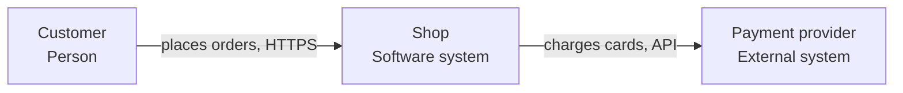

# architecture-decision
Produces `architecture.md` (drivers, options, decision, C4 diagrams,
cross-cutting concerns, risks) and `adr/NNNN-<title>.md` files. For a review,
the same document with findings on the existing system.

## Before you start
| Input | Where | If missing |
|---|---|---|
| Requirements | task, handoffs (scrum, spec), `features.csv` | list the 5 key use cases you assume |
| Quality attributes | task | performance, availability, security, modifiability with modest targets; record them |
| Constraints | task: team size and skills, budget, deadline, mandated tech | small team, one deployable unit preferred |
| Existing system | target folders: code layout, dependencies, deployment files | greenfield |
| Earlier decisions | `adr/`, `docs/architecture*` | none |

## Method
1. **Drivers**: key use cases; quality attributes written as scenarios (format
   below); constraints. Rank the top 3 quality attributes — they decide.
2. **Context**: the system, its users and the external systems (C4 level 1).
3. **Options**: 2–3 structures that could work (e.g. modular monolith vs
   services; synchronous API vs events). For each: how it meets each driver,
   cost, risk, team fit.
4. **Trade-off table**: options × top drivers, with a short reason per cell.
5. **Decide** and write the ADR (template) — status "Proposed" unless the task
   says it is accepted.
6. **Containers** (C4 level 2): deployable units and data stores, technology,
   protocols on arrows. Components (level 3) only for the part that is
   complex or contested.
7. **Cross-cutting**: data ownership per container, API style and versioning,
   integration tactics (checklist), authentication and authorisation flow,
   observability, configuration.
8. **Evolution**: what changes are expected, how the structure absorbs them;
   fitness functions (automated checks such as dependency rules or latency
   budgets); for a migration, the strangler-fig steps.
9. **Risks and debt**: the riskiest assumption and a cheap experiment to test
   it; known debt with its interest (what it slows down).
10. **Write** `architecture.md` and the ADRs.

## Checklists

### Quality-attribute scenario
| Part | Example |
|---|---|
| Source | 200 concurrent users |
| Stimulus | submit an order |
| Environment | normal operation, peak hour |
| Artifact | order service |
| Response | order stored and confirmed |
| Response measure | p95 < 500 ms; 0 lost orders |

### Patterns — when, and when not
| Pattern | Use when | Avoid when |
|---|---|---|
| Layered | simple CRUD, small team | business rules leak into every layer |
| Hexagonal / ports and adapters, clean | rich domain logic, several adapters (web, CLI, queue), testability | thin CRUD: the indirection costs more than it saves |
| Modular monolith | default for a new product: one deployable, strict module boundaries | modules need independent scaling or release cadences already |
| Microservices | independent teams, different scaling or release needs, mature DevOps | one small team, no automated deployments or monitoring yet |
| Event-driven | decoupled reactions, audit trails, integration with many consumers | you need immediate consistency and simple debugging |
| CQRS | read and write models differ a lot, heavy reads | uniform CRUD |
| Event sourcing | full history is a requirement (ledger, audit) | only "nice to have": it is costly to change and query |

### Integration tactics
- Timeouts on every remote call; retries only for idempotent operations, with
  exponential backoff and jitter; circuit breaker for failing dependencies.
- Idempotency keys for operations clients retry (payments, orders).
- Asynchronous messaging: at-least-once delivery means consumers must be
  idempotent; dead-letter queues; outbox pattern to publish events with the
  database change.
- API versioning in the path or header; backward-compatible changes by
  default; contracts documented (OpenAPI, AsyncAPI).
- One owner per piece of data; other components read through its API or
  events, not its tables.

### Review checklist (existing system)
Dependencies between modules point one way (no cycles); domain code free of
framework details; a change typically touches one module; deployable without
downtime; failures of one dependency contained; secrets and configuration
outside the code; observability in place.

## Deliverable
In the shared work folder: `architecture.md` and `adr/0001-<kebab-title>.md`
(one per decision). Translate the headings into the user's language.

```markdown
# Architecture — <system>
## Summary
<the structure in one paragraph, the top 3 drivers, the main trade-off>
## Drivers
### Use cases
### Quality-attribute scenarios
| # | Attribute | Scenario | Response measure | Priority |
### Constraints
## Context (C4 level 1)

## Options
| Driver | Option A: modular monolith | Option B: services |
## Decision
<summary and link to ADR-0001>
## Containers (C4 level 2)
## Components (C4 level 3, where useful)
## Cross-cutting concerns
## Evolution and fitness functions
## Risks and technical debt
| Risk / debt | Impact | Experiment or plan |
## Decisions
## Next steps
```

ADR (Nygard format):

```markdown
# ADR-0001: <decision in a few words>
Status: Proposed | Accepted | Superseded by ADR-000N
Date: <yyyy-mm-dd>
## Context
<forces at play: drivers, constraints, options considered>
## Decision
<what we do, in active voice: "We will ...">
## Consequences
<what becomes easier, what becomes harder, follow-up work>
```

## Pitfalls
- Choosing microservices for a small team without automated deployment.
- Quality attributes as adjectives with no response measure.
- One option presented as if there were no alternative.
- Diagrams mixing C4 levels, unlabelled arrows, boxes without technology.
- Services sharing one database schema.
- Retries on non-idempotent calls; no timeouts.
- ADRs written after the fact without the alternatives considered.
- Designing for a scale ten times beyond any driver.
