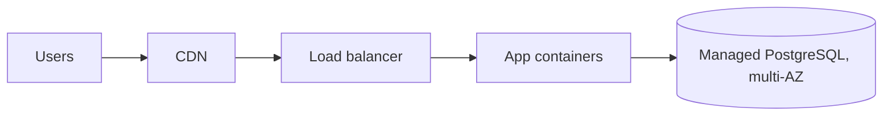

# cloud-architecture
Produces `cloud-architecture.md`: targets, chosen services, diagram, IAM and
network design, resilience, a Well-Architected review, cost drivers, risks and
a migration path when relevant. Design only: nothing is created.

## Before you start
| Input | Where | If missing |
|---|---|---|
| Workload | task, handoffs (architecture, web, data) | describe it in one paragraph and record it |
| Provider | task | compare AWS, Azure and Google Cloud; recommend one with reasons |
| Targets | task | 99.9 % monthly availability, RPO 1 h, RTO 4 h, one region in the EU |
| Load | task | small: <100 requests/s, <100 GB data |
| Compliance and residency | task | GDPR: personal data in an EU region |
| Team skills, existing IaC | task, target folders | managed services over self-run ones |

## Method
1. **Targets table** (availability, RPO, RTO, latency, residency, budget,
   compliance). Availability per month: 99.9 % ≈ 43.8 min downtime, 99.95 % ≈
   21.9 min, 99.99 % ≈ 4.4 min.
2. **Pick a pattern** (below) and the most managed service per component;
   self-managed VMs only when a requirement demands it.
3. **Service table** with real names (mapping below); one row per component,
   with why it was chosen.
4. **Identity**: accounts or subscriptions per environment (at least prod and
   non-prod); human access through SSO and MFA; workloads through roles,
   managed identities or service accounts; no static keys in code.
5. **Network**: a VPC/VNet per environment; public subnets only for load
   balancers or gateways; data in private subnets; private endpoints for
   managed services where available; security groups or NSGs least privilege.
6. **Resilience**: at least two availability zones for production; backups and
   point-in-time recovery sized to the RPO; a DR approach (backup and restore,
   pilot light, warm standby, active-active) sized to the RTO and budget.
7. **Well-Architected review**: the six pillars table below.
8. **Costs**: list the drivers with units and the assumed volumes; if
   WebSearch is available, read the provider's pricing page and cite it with
   the date; otherwise write the units and tell the user to fill the
   provider's pricing calculator. Name the largest driver.
9. **IaC**: recommend Terraform/OpenTofu, or the provider's own (CloudFormation
   or CDK, Bicep), and list the modules for the infra specialist.
10. **Migration** (when moving an existing system): one strategy per
    component (the "Rs" below) and the order of moves.

## Checklists

### Service mapping
| Need | AWS | Azure | Google Cloud |
|---|---|---|---|
| Virtual machines | EC2 | Virtual Machines | Compute Engine |
| Containers without servers | ECS on Fargate | Container Apps | Cloud Run |
| Kubernetes | EKS | AKS | GKE |
| Functions | Lambda | Functions | Cloud Run functions |
| Object storage | S3 | Blob Storage | Cloud Storage |
| Managed relational | RDS, Aurora | Azure Database for PostgreSQL / MySQL, Azure SQL Database | Cloud SQL, AlloyDB |
| NoSQL | DynamoDB | Cosmos DB | Firestore, Bigtable |
| Queues / pub-sub | SQS, SNS, EventBridge | Service Bus, Event Grid | Pub/Sub |
| CDN | CloudFront | Azure Front Door | Cloud CDN |
| DNS | Route 53 | Azure DNS | Cloud DNS |
| Secrets | Secrets Manager | Key Vault | Secret Manager |
| Monitoring | CloudWatch | Azure Monitor | Cloud Monitoring and Logging |
| Identity for workloads | IAM roles | Managed identities | Service accounts, Workload Identity |

Service names change: when unsure of a current name, check the provider's
documentation with WebSearch or say "the provider's managed X service".

### Reference patterns
| Pattern | Fits | Shape |
|---|---|---|
| Static site + CDN | brochure sites, SPAs | object storage + CDN + DNS + certificate |
| Three-tier web | classic apps | load balancer → app (containers) → managed database; cache optional |
| Serverless API | spiky, low-ops APIs | API gateway → functions → managed NoSQL or SQL |
| Event-driven | decoupled processing | producers → queue/pub-sub → consumers; dead-letter queue |
| Data platform | analytics | ingestion → object storage (lake) → warehouse → BI |

### Well-Architected pillars
| Pillar | Check |
|---|---|
| Operational excellence | IaC, monitoring and alerts, runbooks, deployment without downtime |
| Security | least privilege, MFA, encryption, private data paths, audit logs on |
| Reliability | multi-zone, health checks, backups tested, quotas known, retries with backoff |
| Performance efficiency | right-sized instances, caching, CDN, autoscaling with limits |
| Cost optimisation | budget alerts, tagging, scale to zero for dev, storage lifecycle rules |
| Sustainability | right-sizing, managed services, regions and schedules that avoid idle capacity |

### Cost drivers to list
Compute (vCPU-hours or requests and GB-seconds), storage (GB-month by class),
data transfer out (GB), managed database (instance-hours, storage, I/O),
load balancers and NAT gateways (hours plus GB processed), logs (GB ingested
and retained), support plan.

### Migration strategies
Rehost (lift and shift), relocate, replatform, refactor, repurchase (SaaS),
retire, retain — one per component, with the reason.

## Deliverable
`cloud-architecture.md` in the shared work folder (translate the headings into
the user's language):

```markdown
# Cloud architecture — <system>
## Summary
<provider, pattern, availability target, largest cost driver, top risk>
## Targets
| Target | Value | Source (task / assumption) |
## Architecture

## Services
| Component | Service | Why | Equivalents (Azure / Google Cloud) |
## Identity and access
## Network
## Resilience and backups
## Well-Architected review
| Pillar | Status | Gap | Action |
## Cost drivers
| Driver | Unit | Assumed volume | Price source |
## Risks
## Decisions
## Next steps
<modules for infra, pipelines for devops, what the user sets up: accounts, budget alerts>
```

## Pitfalls
- Quoting prices from memory: they differ by region and change; cite or give
  units.
- Kubernetes for a small app a managed container service runs with less work.
- A single-zone database behind a "99.95 %" claim.
- Public IPs on databases or admin panels "for convenience".
- Long-lived access keys in CI or code instead of OIDC and roles.
- Forgetting egress, NAT gateway and log ingestion costs.
- Autoscaling without a maximum, or no budget alert.
- Mixing production and test in one account or subscription.
