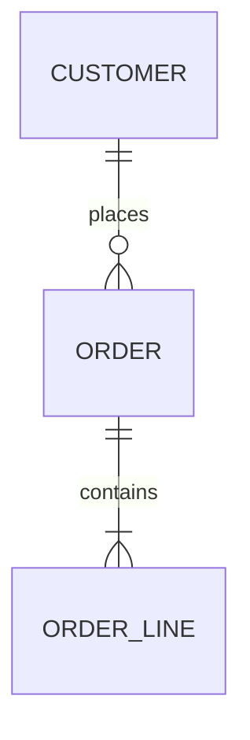

# database-design
Produces `schema.sql` and `database-design.md` (entities, ERD, normalisation
notes, index rationale, sample queries, migrations), or a review of an
existing schema or query.

## Before you start
| Input | Where | If missing |
|---|---|---|
| Domain and rules | task, handoffs (architecture, web, data), existing models | write the rules you assume as sentences |
| Main queries and volumes | task, code (ORM calls, SQL files) | list the 5 queries the features imply; assume 10^5–10^6 rows in the biggest table |
| Engine | task, config, `docker-compose`, ORM settings | PostgreSQL |
| Existing schema | `*.sql`, migrations folder, ORM models | new schema |
| Course conventions (Merise notation, naming) | task | Merise terms alongside ERD; `snake_case` plural-free table names |

## Method
1. **Rules as sentences**: "A customer places 0..n orders; an order belongs to
   exactly 1 customer." Each gives a cardinality.
2. **Conceptual model (MCD / ERD)**: entities, identifiers, attributes,
   associations with cardinalities (Merise writes them at each end, e.g.
   `CLIENT 0,n — passer — 1,1 COMMANDE`). Association attributes stay on the
   association.
3. **Normalise** with the tests below; split until 3NF; note any deliberate
   denormalisation with its reason (a measured read path).
4. **Logical model (MLD)**: 1,n–1,1 → foreign key on the 1,1 side; n,n →
   junction table with a composite key (plus attributes of the association);
   1,1–0,1 → foreign key with `UNIQUE` on the optional side.
5. **Physical model (MPD) / DDL**: types and constraints per the checklist;
   naming: `snake_case`, `id` primary keys or natural keys when truly stable,
   `<table>_id` for foreign keys.
6. **Indexes**: for each main query, the index that serves it (equality
   columns first, then range or sort column); indexes on foreign keys used in
   joins or cascades; nothing else.
7. **Execute** what SQLite accepts:
   ```
   python3 -c "import sqlite3,sys; c=sqlite3.connect(':memory:'); c.execute('PRAGMA foreign_keys=ON'); c.executescript(open(sys.argv[1]).read()); print('ok')" schema.sql
   ```
   For PostgreSQL-only syntax (`SERIAL`, `TIMESTAMPTZ`, `JSONB`, enums), write a
   SQLite-compatible copy for the test only if it is mechanical; otherwise say
   "not executed". Insert a few fake rows and run the sample queries the same
   way.
8. **Migrations**: one file per change, up and down; for live tables use
   expand → migrate data in batches → switch code → contract.
9. **Queries**: parameterised; keyset pagination for large lists; explain how
   to read the plan (sequential scan on a big table, rows estimate vs actual).
10. **Write** the deliverables.

## Checklists

### Normal forms (one-line tests)
| Form | Test | Fix |
|---|---|---|
| 1NF | every column holds one value; no repeating groups (`phone1, phone2`) | child table |
| 2NF | with a composite key, no column depends on only part of it | move it to the table of that part |
| 3NF | no non-key column depends on another non-key column (`zip → city`) | move it to its own table |
| BCNF | every determinant is a candidate key | split; rarely needed beyond 3NF in practice |

### Types and constraints
| Data | Use | Avoid |
|---|---|---|
| Money | `NUMERIC(12,2)` / `DECIMAL`, or integer cents | `FLOAT`, `REAL`, `MONEY` |
| Instants | `TIMESTAMPTZ` (PostgreSQL), UTC by convention elsewhere | local time without zone |
| Identifiers | `BIGINT GENERATED ALWAYS AS IDENTITY` or UUID (v7 for index locality when available) | business data as primary key when it can change |
| Text | `TEXT`/`VARCHAR(n)` with a `CHECK` for real limits | arbitrary `VARCHAR(255)` everywhere |
| Status | `CHECK (status IN (...))` or a lookup table | free text |
| Booleans | `BOOLEAN NOT NULL DEFAULT false` | nullable flags |
| Lists | child table | comma-separated values |

Every foreign key: `ON DELETE RESTRICT` (default safe), `CASCADE` (owned
children such as order lines) or `SET NULL` (optional link), chosen per
relationship. SQLite enforces foreign keys only with `PRAGMA foreign_keys=ON`.

### Indexes
- Composite index order: equality columns, then the range or `ORDER BY`
  column; an index on `(a, b)` serves `a` alone, not `b` alone.
- Unique business keys get a `UNIQUE` constraint (which creates the index).
- Each extra index slows every insert and update: justify it by a query.
- Partial indexes for hot subsets (`WHERE deleted_at IS NULL`) on PostgreSQL.

### Transactions and isolation
| Level | Prevents | Still possible |
|---|---|---|
| Read committed (PostgreSQL default) | dirty reads | non-repeatable reads, lost updates without locking |
| Repeatable read (MySQL InnoDB default) | non-repeatable reads | write skew |
| Serializable | all anomalies | serialization failures: the code must retry |

Lost updates: `SELECT ... FOR UPDATE`, optimistic version column, or an
atomic `UPDATE ... SET qty = qty - 1 WHERE qty > 0`.

### NoSQL by access pattern
List the queries first; embed what is read together and bounded in size;
reference what grows without limit or is shared; one document or item per
aggregate; duplicate deliberately and say who updates the copies. Prefer
relational when the data has many relationships and ad-hoc queries.

### Security and operations
Separate roles: owner (migrations), application (DML on its tables only),
read-only (reporting). Encryption in transit; PII columns identified with
their retention. Backups: logical dumps plus point-in-time recovery where the
engine supports it; restores tested.

## Deliverable
In the shared work folder (or the target's migrations folder): `schema.sql`,
`migrations/NNNN_<name>.up.sql` / `.down.sql` when asked, and
`database-design.md` (translate the headings into the user's language):

```markdown
# Database design — <system>
## Summary
## Business rules
## Conceptual model (MCD / ERD)

## Entities
| Table | Purpose | Key | Main columns | Constraints |
## Normalisation notes
## Indexes
| Index | Serves query | Why |
## Sample queries
## Migrations and changes
## Validation
<executed in SQLite: yes/no, command, result>
## Decisions
## Next steps
```

## Pitfalls
- Designing tables before writing the rules and queries.
- Money in floats; local times without a zone.
- Many-to-many stored as an array or a delimited string.
- Missing indexes on foreign keys, or an index on every column.
- `ON DELETE CASCADE` on a link that should block the delete.
- A migration that rewrites a big table in one transaction during the day.
- `SELECT *` and string-built SQL in sample code.
- Claiming the DDL works when it was never executed.
