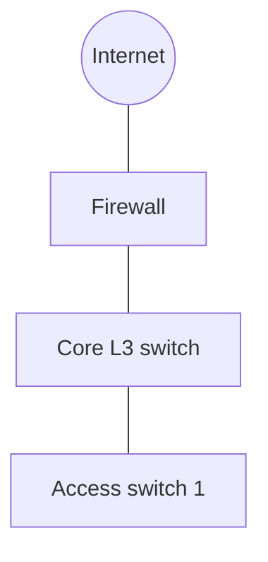

# network-design
Produces `network-design.md` (requirements, addressing plan, VLAN table,
routing, services, security, Wi-Fi, VPN, diagram, configuration examples) or,
for a fault, a troubleshooting report. Every subnet is computed by `subnet.py`.

## Before you start
| Input | Where | If missing |
|---|---|---|
| Sites, buildings, floors | task, handoffs | one site |
| Devices per function (users, servers, VoIP, printers, cameras, guests, management) | task, inventory files | estimate from the user count; record it |
| Growth | task | +30 % per subnet |
| Existing addressing, equipment, ISP links | target files, configs | none: new design |
| Address space | task | `10.<site>.0.0/16` per site (RFC 1918) |
| Course conventions (Cisco Packet Tracer, gateway = last or first address) | task | first usable address = gateway |

## Method
1. **Requirements table**: segment, devices now, devices with growth, needs
   (isolation, QoS, PoE, Wi-Fi).
2. **Addressing.** Add the gateway and infrastructure addresses to each count,
   then run:
   `python3 .claude/skills/network-design/subnet.py plan <parent> <n1> <n2> ... --names a,b,c`
   (`--json` to read it back reliably). If it does not fit, enlarge the parent
   or split by site. Point-to-point router links: `/30`, or `/31` with
   `--allow-31` when the equipment supports RFC 3021. Copy the tool's numbers;
   do not recompute them by hand. `subnet.py info <addr/prefix>` answers any
   single-subnet question (mask, wildcard, broadcast, range, kind).
3. **IPv6** (when asked or dual-stack): a /48 per site, a /64 per VLAN, the
   VLAN id in the fourth hextet (`2001:db8:abcd:<vlan>::/64`); SLAAC for
   clients, DHCPv6 or static for servers.
4. **VLANs**: one per function; ids and names consistent across switches;
   management VLAN separate; native VLAN unused (e.g. 999); access ports carry
   one VLAN, trunks only the VLANs they need.
5. **Switching**: RSTP (or MSTP) with the root bridge set on the core;
   PortFast and BPDU Guard on edge ports; port security or 802.1X on user
   ports; LACP for uplink redundancy.
6. **Routing**: inter-VLAN routing on a layer-3 switch (SVIs) or
   router-on-a-stick; static routes for a small site and a default route to the
   edge; OSPF single area 0 for several routers; BGP only towards ISPs.
7. **Services**: DHCP scopes per VLAN with reservations for printers and
   servers (relay `ip helper-address` when the server is elsewhere); internal
   DNS with forwarders; NTP for every device; NAT/PAT at the edge.
8. **Security zones**: internet, DMZ, servers, users, guests, management; a
   rule matrix (source zone → destination zone → service → allow/deny), default
   deny, logging on denies; management reachable only from the admin VLAN over
   SSH.
9. **Wi-Fi and VPN** per the checklists below.
10. **Diagram** in Mermaid (`flowchart`) with the same names as the tables;
    then write `network-design.md`.
11. **Troubleshooting mode**: follow the OSI ladder below, one hypothesis at a
    time, with the command output as evidence.

## Checklists

### Addressing
| Item | Rule |
|---|---|
| Private ranges | 10.0.0.0/8, 172.16.0.0/12, 192.168.0.0/16 (RFC 1918); avoid 192.168.0.0/24 and 192.168.1.0/24 when VPN users connect from home routers |
| Gateway | the same position in every subnet (first usable by default) |
| Reserved | first 10 addresses of each user subnet for infrastructure (gateway, switches, APs) |
| Growth | ≥ 20 % free in each subnet; spare blocks left contiguous for later |
| Summarisation | one block per site so a single route covers it |

### VLAN table columns
VLAN id · name · purpose · subnet · gateway · DHCP range · switch ports or
SSID · notes. Typical: 10 users, 20 servers, 30 VoIP, 40 printers, 50 guests,
99 management, 999 native (unused).

### Wi-Fi
- 2.4 GHz: channels 1, 6, 11 only (20 MHz). 5 GHz and 6 GHz preferred for
  capacity; 40/80 MHz only where there are enough channels.
- WPA3-Personal or WPA3-Enterprise; WPA2-AES at least; never WEP or TKIP.
- Guest SSID on its own VLAN, client isolation, internet only.
- One AP per 25–30 active clients as a planning figure; a site survey by the
  user confirms coverage.

### VPN
| Need | Choice |
|---|---|
| Site to site | IPsec IKEv2 with AES-GCM; subnets that do not overlap |
| Remote users | WireGuard or OpenVPN; split tunnel only for internal prefixes |
| Authentication | certificates or strong keys per user; revocation possible |

### Troubleshooting ladder (bottom-up)
| Layer | Question | Evidence (read-only) |
|---|---|---|
| 1 Physical | link up, right port? | `ip link` (state UP), the user's look at LEDs |
| 2 Data link | right VLAN, MAC learned? | switch output the user pastes (`show vlan brief`, `show mac address-table`) |
| 3 Network | address, mask, gateway, route? | `ip addr`, `ip route`, `ping -c 4 <gateway>`, `traceroute <host>` |
| 4 Transport | port open, firewall? | rule matrix review; the user tests the service port |
| 7 Application / DNS | name resolves, service answers? | `dig <name>`, `nslookup <name>`, `host <name>` |

Windows: `ipconfig /all` is allowed; `tracert` and `ping` defaults differ —
give the user the command.

## Deliverable
`network-design.md` in the shared work folder (translate the headings into the
user's language):

```markdown
# Network design — <site / project>
## Summary
<3 lines: sites, segments, address space, key choices>
## Requirements
| Segment | Devices now | With growth | Needs |
## Addressing plan
| Name | VLAN | Network | Mask | Gateway | First–last usable | Broadcast | Usable | Free |
<copied from subnet.py; command used: `subnet.py plan ...`>
## VLANs
| VLAN | Name | Purpose | Subnet | Ports / SSID |
## Switching and routing
## Services (DHCP, DNS, NTP, NAT)
## Security zones
| From | To | Service | Action | Reason |
## Wi-Fi
## VPN
## Diagram

## Configuration examples (to adapt, not applied)
## Decisions
## Next steps
<what the user configures, tests and in which order; rollback for risky steps>
```

Troubleshooting: `network-troubleshooting.md` with symptom, environment, each
hypothesis with its test and result, root cause, fix, and how to verify it.

## Pitfalls
- Computing masks or ranges by head: one off-by-one breaks the whole plan.
- Forgetting the gateway, switches and APs in the host counts.
- Allocating small subnets first and fragmenting the space.
- VLAN 1 as user or native VLAN; trunks allowing every VLAN.
- DHCP scopes overlapping static reservations or the gateway.
- Overlapping subnets between sites joined by a VPN.
- Firewall rules written allow-by-default, or without the return path for a
  stateless ACL.
- A diagram whose names or VLAN ids differ from the tables.
- Configuration snippets presented as tested when they were not applied.

## Tool
`subnet.py` — standard library (`ipaddress`), no network access.

```
python3 .claude/skills/network-design/subnet.py plan <parent/prefix> <hosts> [<hosts> ...] [--names a,b] [--allow-31] [--json]
python3 .claude/skills/network-design/subnet.py info <address/prefix> [--json]
```
- `plan`: IPv4 VLSM, largest subnet first, each aligned on its size; a count of
  h gets the smallest prefix with 2^(32-p) − 2 ≥ h (down to /30; with
  `--allow-31`, 2 → /31 and 1 → /32). Prints name, hosts, network, mask,
  first/last usable, broadcast, usable, waste, then the free blocks.
- `info`: network, mask, wildcard, broadcast, usable range and count, and the
  kind (RFC 1918 private, RFC 6598 shared, loopback, link-local, ULA,
  documentation, global); IPv6 gives the prefix, size and range.
- Exit 0 ok, 1 the plan does not fit (the message gives the parent size that
  would), 2 bad input. `--json` prints one object.
